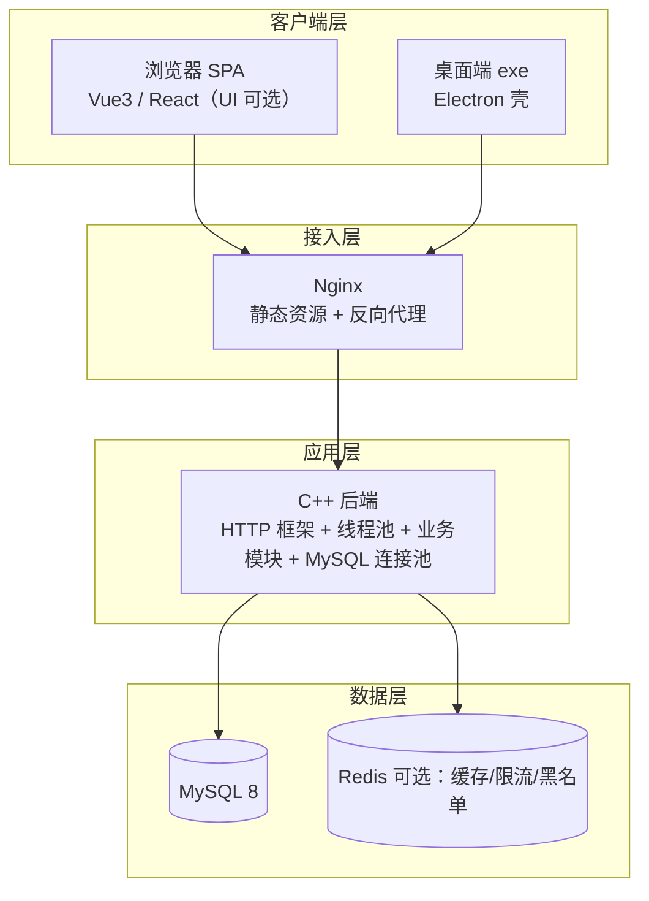

# 全栈个人博客系统 项目书

> 项目定位：面向个人技术写作与求职背书的全栈工程作品。
> 交付形态：**在线网站（Web）** 与 **桌面应用（exe）** 双形态。
> 技术栈（2026-10-16 确定）：**后端 C++、数据库 MySQL、前端多 UI 可选、部署阿里云**。
> 计划周期：8 周。作者：\_\_\_（简历投递前填写）。

---

## 1. 项目背景与目标

**背景**：需要一块可验证的全栈工程能力载体——既要满足日常技术写作与知识沉淀，又要作为简历主力项目接受面试深挖。

**目标**：交付一套可上线运行的博客平台，覆盖内容管理、评论互动、检索、部署运维全链路；同步产出桌面端 exe 与在线网站双形态。

**成功标准**：
- 前后台功能完整可用，接口文档齐全；
- 一键部署可复现（阿里云上可跑通）；
- 至少 2 个技术难点能在面试中讲清原理；
- GitHub 开源 + README + 架构图 + 演示截图齐全，可直接进简历。

## 2. 产品形态

| 形态 | 说明 |
| --- | --- |
| 形态 A：在线网站（Web） | 前后端分离 SPA，公网可访问，支持全量功能 |
| 形态 B：桌面应用（exe） | Electron 打包 Windows 免安装 exe，复用 Web 前端；支持本地写作、离线阅读、一键发布 |

双形态复用同一套核心代码（前端同源），差异只在外壳与本地能力，体现工程抽象能力。

## 3. 功能需求

### 前台（访客 / 普通用户）
- 文章列表分页，按时间、浏览量排序；
- 文章详情，Markdown 渲染 + 代码高亮；
- 标签分类筛选；全文检索（MySQL 起步，预留 Elasticsearch）；
- 浏览计数；用户评论；暗黑模式；图片懒加载。

### 后台（博主）
- JWT 登录、身份校验、极简 RBAC（管理员 / 作者）；
- 文章新建、编辑、存草稿、发布、删除；
- 标签管理；图片上传（本地存储，预留对象存储）；
- 评论管理；数据看板（文章数、总访问量）。

### 桌面端
- 本地草稿、离线缓存；一键发布到云端；托盘快捷入口、系统通知。

## 4. 非功能需求

- **性能**：C++ 高并发模型（线程池 + 连接池）+ 列表分页 + 热点缓存 + 限流；
- **安全**：输入校验、SQL 预编译防注入、XSS 防护、密码加密（bcrypt）、JWT 黑名单登出；
- **兼容**：现代浏览器、Windows 10/11；
- **可维护**：模块化拆分、API 文档、结构化日志。

## 5. 技术架构（示意）

数据流：客户端 → Nginx → C++ 后端 → MySQL / Redis；热门文章缓存于 Redis，浏览计数先写 Redis 再定时批量落库。

## 6. 技术栈

| 层次 | 选型 | 说明 |
| --- | --- | --- |
| 后端 | C++（cpp-httplib 起步 → Crow / Drogon 进阶） | 高并发、贴近底层，简历差异化强 |
| 数据库 | MySQL 8（mysql-connector-c++ / libmysqlclient + 连接池） | SQL 预编译防注入 |
| 缓存 | Redis（可选） | 热点缓存、限流、JWT 黑名单 |
| 鉴权 | JWT（HMAC-SHA256，C++ 侧实现签名校验） | 无状态鉴权 |
| 前端 | 多 UI 可选：Vue3 + Element Plus / React + Ant Design | UI 视觉可参考开源模板 |
| 桌面端 | Electron | 复用 Web 前端，打包 exe |
| 接口文档 | OpenAPI 描述 / 手写 API 文档 | 面试可讲 |
| 部署 | 阿里云 ECS/轻量 + Nginx + systemd（可选 Docker） | 免费额度起步 |

## 7. 数据库设计

| 表 | 关键字段 | 说明 |
| --- | --- | --- |
| user | id, username, password(bcrypt), avatar, role, created_at | 用户表 |
| article | id, title, content, summary, cover_img, status(草稿/发布), view_count, user_id, created_at, updated_at | 文章表 |
| tag | id, name, created_at | 标签表 |
| article_tag | id, article_id, tag_id | 文章-标签中间表 |
| comment | id, article_id, user_id, content, created_at | 评论表 |

预留：setting（站点配置）、visit_log（访问日志）。

## 8. 模块与核心接口

模块：auth、user、article、tag、comment、upload、stat。

| 接口 | 说明 |
| --- | --- |
| POST /api/auth/login、/register | 登录 / 注册 |
| GET /api/articles（分页、筛选、排序） | 文章列表 |
| GET /api/articles/:id | 文章详情（含浏览计数） |
| POST/PUT/DELETE /api/articles/:id | 文章增删改（需鉴权） |
| GET /api/tags | 标签列表 |
| GET/POST /api/comments | 评论查询 / 发布 |
| POST /api/upload/image | 图片上传 |
| GET /api/stat/overview | 数据看板 |

## 9. 关键技术难点与解决方案

1. **C++ 后端线程模型与连接池**：HTTP 服务线程池 + MySQL 连接池，避免每次请求建连开销；能讲清请求并发模型与阻塞点。
2. **内存与安全**：智能指针 / RAII 管理生命周期；输入校验；SQL 预编译防注入；JSON 用 nlohmann/json。
3. **Markdown 渲染与 XSS**：用户提交内容存在注入风险。前端使用安全解析库（DOMPurify 白名单过滤）+ 后端输入转义，危险标签剔除。
4. **浏览量高频更新**：计数先写 Redis，定时任务批量落库，缓解 MySQL 写压力，保证最终一致。
5. **接口防刷**：Redis 滑动窗口限流，按 IP + 接口维度。
6. **JWT 登出失效**：JWT 无法主动作废。Redis 黑名单，登出即入黑名单，过期自动清理。
7. **双端复用与打包**：Electron 主 / 渲染进程职责拆分、IPC 通道设计；只打 Windows 单平台控制体积。

## 10. 开发计划（8 周）

| 阶段 | 时间 | 内容 | 产出 |
| --- | --- | --- | --- |
| 需求与设计 | 第 1 周 | 功能清单、DB 建模、API 设计、UI 选型 | 设计文档 |
| 后端开发 | 第 2-3 周 | C++ 后端：HTTP 框架、连接池、auth/article/tag/comment、JWT | 可用 API |
| 前端开发 | 第 4 周 | 选定 UI（Vue3 / React）+ 列表/详情/后台管理 | 可用页面 |
| 性能与安全 | 第 5 周 | Redis 缓存、限流、XSS 防护、计数落库 | 优化项 |
| 桌面端 | 第 6 周 | Electron 壳、本地草稿、一键发布 | 可运行 exe |
| 测试修复 | 第 7 周 | 功能回归、移动端适配、边界用例 | 稳定版本 |
| 上线与沉淀 | 第 8 周 | 阿里云部署、README、简历描述 | 上线作品 |

## 11. 部署方案（阿里云）

**免费 / 低价通道（2026-10 公开活动，以阿里云官网实际为准）**：
- 新用户免费试用：ECS 免费额度 300 元 / 3 个月（每小时抵扣上限约 0.833 元，北京 / 香港等 7 地域）；
- 另有 1 个月按量 ECS 试用（搭配节省计划每小时 0.99 元额度抵扣）；
- 学生：云工开物（学信网认证）可领 1核2G ECS 最长免费 12 个月（领取后 1 个月内完成指定实验与认证任务）；或学生 ECS 99 元 / 年；
- 轻量应用服务器：新用户 2核2G 秒杀价 38 元 / 年。

**部署路径**：Linux + Nginx 反向代理 + systemd 托管 C++ 进程；MySQL 同机安装或 RDS；图片预留对象存储 OSS；定时备份数据库；可选 HTTPS 证书。

## 12. 验收标准（Checklist）

- [ ] 前后台全部功能可用，接口文档完整；
- [ ] 一键部署脚本可复现（新环境可跑通）；
- [ ] 桌面端 exe 可安装 / 免安装运行，并能发布文章；
- [ ] 至少 2 个技术难点可讲清原理与权衡；
- [ ] GitHub 仓库：README + 架构图 + 演示截图 + 提交记录完整。

## 13. 风险与应对

| 风险 | 应对 |
| --- | --- |
| C++ 后端开发周期长 | 用 cpp-httplib 起步控制范围，功能按优先级裁剪，MVP 先行 |
| Electron 打包体积大 | 仅打 Windows 单平台、剔除冗余依赖 |
| 面试深挖底层 | 每模块写文档、代码加注释、整理面试话术 |
| 免费服务器到期 | 提前备份与迁移预案；可续学生 / 新用户优惠 |

## 14. 迭代路线图

- v1.0 MVP：双形态上线（第 8 周达成）；
- v1.1：对象存储、Elasticsearch 检索、邮件通知；
- v1.2：点赞收藏、多作者协作、桌面端自动更新；
- v1.3：主题市场、移动端深度优化、性能监控。

## 15. 求职价值与简历描述

**定位**：简历主力项目，与 GitHub 开源仓库、技术博客文章形成组合拳。C++ 后端是全栈简历里的差异化亮点。

**简历项目描述（可直接使用）**：

> 全栈个人博客系统（Web + 桌面 exe）｜独立开发
> 技术栈：C++（cpp-httplib / Drogon）、MySQL、Redis、Vue3 / React、Electron、阿里云
> 独立完成数据库设计与 C++ 后端开发，实现 JWT 鉴权、RBAC、Markdown 发布、图片上传、评论与浏览统计；实现 MySQL 连接池与线程池模型，热点文章走 Redis 缓存、浏览计数定时批量落库缓解写压力；增加接口限流与 XSS 防护；Electron 打包桌面端支持本地草稿与一键发布；部署至阿里云，配套 API 文档与开源 README。

---
